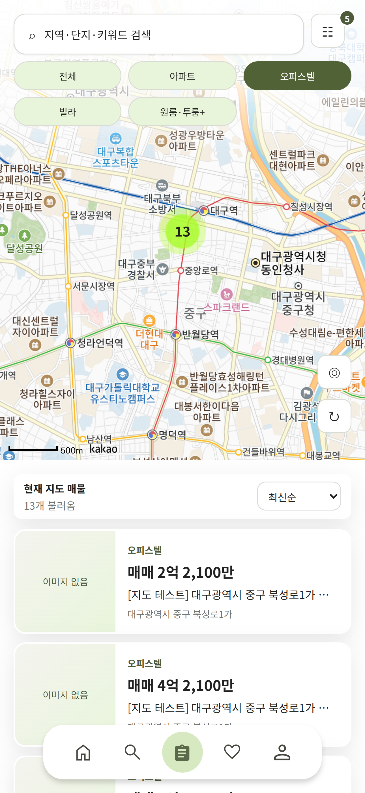
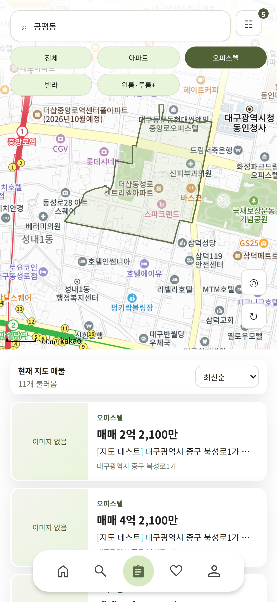
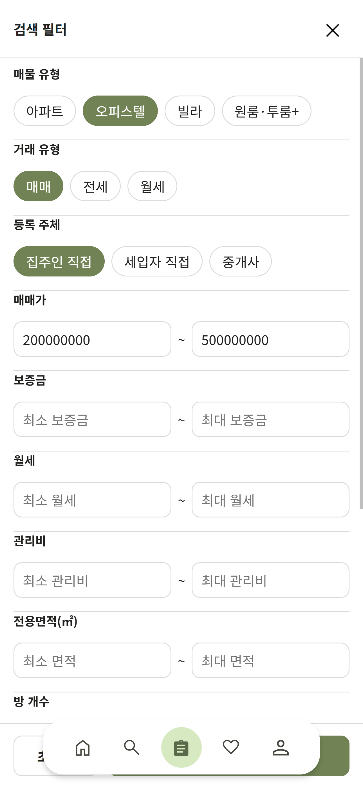
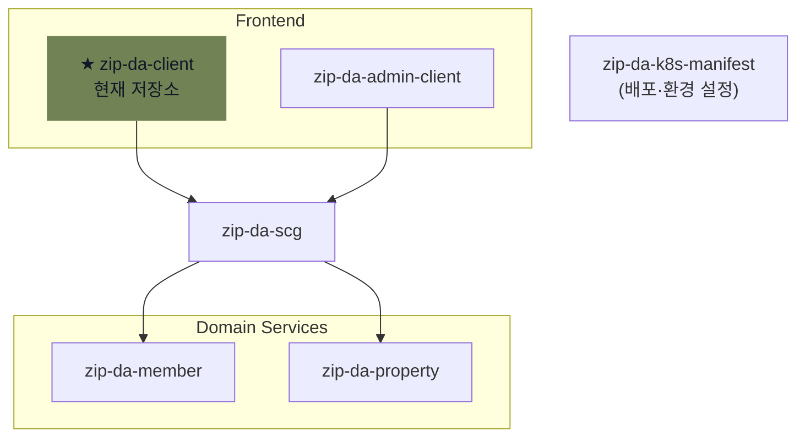

# ZIPDA Client

> **ZIPDA**는 사용자와 중개사를 연결하고 회원 관리, 중개사 인증, 매물 탐색·관리 기능을 제공하는 **MSA(Microservices Architecture)** 기반 부동산 서비스이다.

`zip-da-client`는 일반 사용자와 중개사가 사용하는 Vue 기반 웹 애플리케이션이다. 모바일 화면을 우선으로 설계하며 SCG를 통해 Member·Property 서비스와 연동한다.

## 대표 화면

  
  
  

## ZIPDA MSA 구성

## 주요 기능

1. **지도 기반 매물 검색**
   - 지역 검색과 행정구역 경계 표시
   - 지도 영역·확대 단계 기반 매물 조회
   - 매물·거래 유형, 가격, 면적, 등록 주체 및 상세 조건 필터
   - 지도와 목록의 검색 조건·선택 상태 연동
   - 이전 요청 취소와 최신 검색 결과 반영

2. **매물 조회와 관리**
   - 공개 매물 상세 조회
   - 사용자·중개사 매물 등록과 수정
   - 내 매물 목록, 거래 상태 및 검증 신청 관리

3. **회원 기능**
   - 이메일 회원가입과 로그인
   - 비밀번호 재설정·변경
   - 회원 프로필과 마이페이지

4. **중개사 기능**
   - 중개사 전환 신청과 서류 업로드
   - OCR 결과 확인과 신청 정보 입력
   - 중개사 공개 프로필 조회·관리

5. **관심 매물 저장 — 찜 기능**
   - 매물 찜 등록·해제
   - 관심 매물 목록과 매물 유형별 필터

## 기술 스택

| 구분 | 기술 |
| --- | --- |
| 프론트엔드 | Vue 3, Vue Router |
| 상태 관리 | Pinia |
| HTTP 통신 | Axios |
| 지도 | Kakao Maps SDK |
| 빌드 | Vite, Node.js 24 |
| 배포 | Docker, Nginx |

## 문서

| 문서 | 내용 |
| --- | --- |
| [서비스 개요](./zip-da-client-doc/01-service-overview.md) | 서비스 역할과 모바일 퍼스트 UI |
| [프론트엔드 아키텍처](./zip-da-client-doc/02-frontend-architecture.md) | Vue 구조와 상태·요청 처리 |
| [인증과 접근 제어](./zip-da-client-doc/03-authentication-and-api-integration.md) | 인증 정보 관리, 라우트 접근 제어와 Frontend·Backend 인증 책임 |
| [주요 기능](./zip-da-client-doc/04-key-features.md) | 지도 검색·매물·회원·중개사·찜 기능 |
| [개발 환경 세팅](./zip-da-client-doc/05-development-setup.md) | 개발 도구, 환경 변수와 로컬 실행 방법 |
