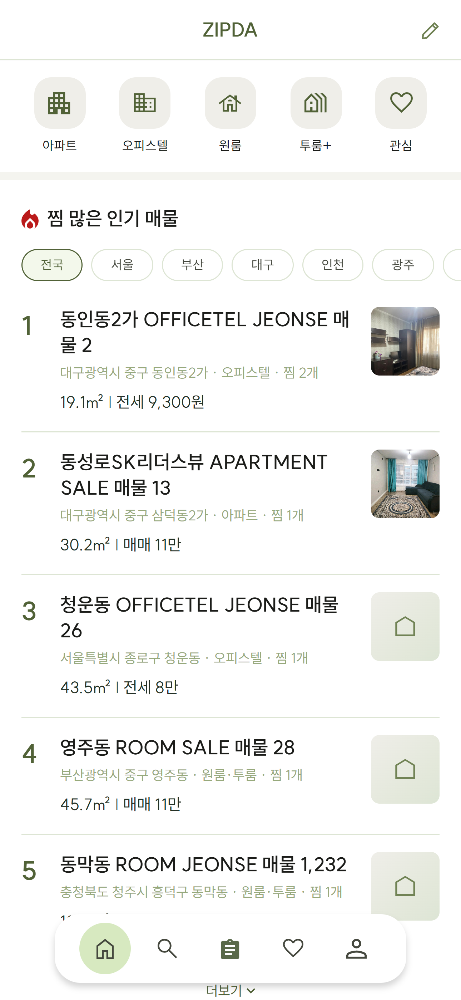

# Client 서비스 개요

## 1. 서비스 소개

`zip-da-client`는 ZIPDA MSA의 사용자 프론트엔드이다. 일반 사용자와 중개사가 모바일 환경에서 매물을 검색하고 회원·매물 업무를 처리하는 화면을 제공한다.

핵심 기능은 지도 기반 매물 검색이다. 지역 검색, 지도 영역별 조회, 상세 필터와 목록·상세 화면을 하나의 탐색 흐름으로 제공한다.

## 2. 서비스 역할

- `zip-da-client`: 사용자 화면과 브라우저 상태 관리
- `zip-da-scg`: API 라우팅과 JWT 검증
- `zip-da-member`: 회원·인증·중개사 기능
- `zip-da-property`: 지도 검색·매물·찜 기능

## 3. 모바일 퍼스트 UI

모바일 화면을 기본으로 구성하고, 넓은 화면에서는 지도·목록 분할과 콘텐츠 폭 확장 등 화면별 반응형 레이아웃을 적용한다.

- 전체 화면 지도와 하단 결과 패널
- 모바일 하단 내비게이션
- Safe Area를 고려한 하단 여백
- 전체 화면 지역 선택과 검색 필터
- 데스크톱 지도·목록 분할 화면

  

## 4. 서비스 제공 기능

| 영역 | 제공 기능 |
| --- | --- |
| 검색 | 지역·지도 영역 검색, 상세 필터, 지도·목록 연동 |
| 매물 | 공개 상세, 등록, 수정, 내 매물, 검증 신청 |
| 회원 | 이메일 회원가입·로그인, 비밀번호, 프로필 |
| 중개사 | 전환 신청, 서류 업로드, OCR 결과, 공개 프로필 |
| 관심 매물 | 찜 등록·해제와 목록 조회 |

